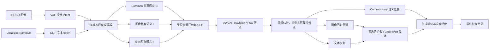

# 面向不可靠信道的图文多模态语义通信与安全生成恢复

## 1. 项目概述

本项目研究如何在带宽受限且受噪声、衰落与信道状态不确定性影响的通信环境中，联合传输一幅图像及其文本描述，并在接收端完成图像重建、文本恢复与高层语义保留。项目不把图像与文本视为两个完全独立的信息源，而是将两者分解为共享语义、图像私有细节和文本私有细节三类表示，并在固定或受控的信道资源内完成联合编解码。

项目的核心矛盾是，低信噪比下的传统回归式重建往往模糊且缺少结构细节，而扩散模型或 ControlNet 等生成模型虽能产生更清晰的结果，却可能改变人物、物体、姿态或场景布局。因此，本项目不是简单地将生成模型接到通信系统之后，而是逐步形成了“接收可靠性估计——传输模式选择——差异保护——回归或生成恢复——生成结果验证与拒绝”的闭环接收机。

从整体演进看，V6 系列重点探索自适应带宽、生成恢复及其安全性；V7–V9 逐步将 Common 共享语义从辅助分支提升为低码率语义保底层；V10 则在 V9 主干上补全复信号 Rayleigh 衰落、自由空间光通信（free-space optical communication, FSO）、导频信道估计、均衡、有噪反馈和模式声明等物理与协议环节。

## 2. 整体系统框架

系统的源端输入为 COCO 图像及其 Localized Narratives 文本描述。图像通过 Stable Diffusion VAE 转换为视觉 latent，文本通过 CLIP 文本编码器转换为 token 表示。多模态编码器将它们分解为 Common（C）、Image-private（I）和 Text-private（T）三组语义 token，然后投影到信道潜变量空间。接收端从受损 token 中恢复图像 latent、文本 token 以及可独立评估的 Common 语义表示。

评价不仅关注像素层的 PSNR 和 SSIM，还关注 CLIP 语义相似度、文本 token accuracy、BLEU-2、Common 到文本的检索召回率、生成接受率、误接受率、平均/峰值功率、实际信道使用次数和推理延迟。由于生成模型可能提升感知质量却降低像素一致性，本项目强调同时报告语义收益与结构/像素代价，不以单一指标宣称优势。

## 3. 版本演进总览

| 版本 | 主要问题 | 核心变化 | 现有证据级别 |
|---|---|---|---|
| V6.1 | 建立可训练的图文联合语义通信基线 | 补齐数据、损失、训练、评估和多带宽入口 | 方法与实验流程；结果文件缺失 |
| V6.2 | 只按 SNR 决定生成过于粗糙 | 无参考质量路由、文本 UEP、语义扩散适配器 | 数值/架构自检与试验设计 |
| V6.3 | prompt-only 扩散不能修正空间错位 | ControlNet Tile + img2img + 保守融合 | 小样本 oracle pilot |
| V6.4 | oracle 候选不能在真实接收机中使用 | 将 oracle 决策蒸馏为接收端策略 | pilot 结果与留出评估方案 |
| V6.5 | 生成候选仍可能改变实体和布局 | 生成—验证—拒绝接收机 | 小样本行为观察 |
| V6.5.1 | 连续增益回归头出现均值回归 | 三个安全分类头、部署加权、接收文本择优 | 13 个实际候选的诊断 |
| V6.6 | 接收回归图缺少可信空间布局 | 低分辨率结构侧信道 + Canny ControlNet | oracle/有噪试验设计；正式结果缺失 |
| V7-A | Common 语义容量与可辨识性不足 | C16→C32、InfoNCE、三阶段课程 | 筛选准则；数值缺失 |
| V7-B | 共享语义加强可能伤害回归主任务 | C32/I224/T32、Common 粗结构回归、SNR 文本门控 | 消融方案；数值缺失 |
| V8-A | 置零私有 token 不等于低码率 Common-only | 真实 C-only 传输与独立 Common 任务头 | 资源合同明确；性能数值缺失 |
| V9-A | 不同可靠性下的图像与文本需求不同 | 重建/混合/生成三模式和固定总额度动态分配 | 完整代码与协议；正式指标缺失 |
| V9-B→B.2 | 生成接受策略的模式差异和效用校准不足 | Common 引导验证、模式专家、效用头与连续边界校准 | 失败模式记录；正式结果缺失 |
| V10-A | 简化 AWGN 不足以支撑物理信道主张 | Rayleigh/FSO、导频 CSI、均衡、有噪反馈、UEP、接收适配器 | 23 项物理/集成测试；真实性能未测 |

## 4. 各版本详细改动、创新与结果变化

### 4.1 V6.1：完整带宽实验基线

V6.1 建立了项目的基础闭环：图像与文本经过语义编码、信道传输和接收端解码，同时输出图像重建与文本恢复。该版本的工程贡献是补齐 COCO 数据加载、多模态损失、训练、评估、多随机种子汇总以及可调带宽入口，使原始 4608 次实值信道使用与 6912、8064、9216 等更高带宽配置能够在统一流程中对比。

当前 source-only 压缩包没有附带 V6.1 的 `experiment_results` 和主模型 checkpoint，因此无法从该包中恢复各带宽的 PSNR、SSIM 或文本指标。此外，新的带宽实验使用官方 COCO Captions，而原权重配置曾使用 Localized Narratives；两者不应被宣称为逐样本复现。

### 4.2 V6.2：质量自适应带宽与生成恢复

V6.2 不再把“SNR 低于固定阈值”直接等同于“应该调用扩散模型”，而是使用接收端无参考质量与可靠性特征区分同一 SNR 下的不同恢复难度。系统先进行一次中性配额传输；若文本不可靠，则在固定总 token 预算内从图像私有 token 向文本 token 让渡资源，并重复发送高重要性的有效文本 token；只有在文本可信且图像结构质量不足时，才考虑生成恢复。

该版本的主要创新是接收反馈辅助的动态配额和有效文本 token 重复保护，而非发送 padding 或凭空增加带宽。代码还将接收语义映射为 Stable Diffusion 的 cross-attention 条件 token，用于减少 prompt-only 生成对原图的重画。

V6.2 文档记录了一项本地数值自检：在 0 dB 下，文本 utility 从 0 提高到 1 后，文本特征 MSE 约从 0.505 降至 0.125，同时图像 token 从 256 降至 208。这一结果证明了文本重复保护与图像细节之间的可控权衡，但它属于架构/数值自检，不是严格留出集上的最终系统性能。

### 4.3 V6.3：ControlNet Tile 空间约束试验

V6.2 的实际 pilot 显示，prompt-only 和全局语义 token 对语义有一定影响，但不足以修正低 SNR 回归图中的人物、家具和背景空间错位。V6.3 因此将接收文本用作 Stable Diffusion 语义条件，将接收端回归图同时用作 img2img 初始图和 ControlNet Tile 空间条件，并扫描扩散强度、RGB 融合与细节融合等选项。

该版本的目标是验证“具有空间约束的生成专家是否存在正收益上限”。原图只用于 pilot 阶段的 oracle 评分，不是接收端输入，因此 oracle 结果不能直接作为可部署系统性能。

### 4.4 V6.4：无参考自适应 ControlNet 恢复

V6.4 使用原图在离线数据采集阶段为候选生成结果构建 oracle 标签，再将这一决策蒸馏为只读取接收端特征的轻量策略。策略联合输出文本配额、回归/生成路由、扩散强度、融合专家和融合系数，最终评估则排除所有策略训练图像 ID。

项目文档引用的 V6.3 oracle pilot 包含 12 个样本，ControlNet Tile 与保守融合的生成正样本比例为 66.7%，平均 CLIP image 指标约增加 0.0288，PSNR 约变化 -0.0107 dB。这组数据支持“新生成专家存在正收益潜力”，但样本很小且选择依赖 oracle，不支持稳健性或泛化性结论。

### 4.5 V6.5：生成—验证—拒绝式接收机

V6.4 通过校准路由阈值将生成调用率从约 79% 降低到约 21%，但仍出现生成图与接收文本在高层语义上相似、却改变了人物、姿态、物体或场景细节的案例。V6.5 因此在第一阶段 ControlNet 路由之后加入第二阶段接收端验证器，预测接受概率、幻觉风险及 CLIP、PSNR 和 SSIM 的变化；只有验证通过才输出生成候选，否则退回原回归图。

该版本的关键思想是将“是否值得生成”和“生成结果是否安全”分成两个决策。现有文档记录了调用率变化和具体失败案例，但没有附带留出评估目录中的 `summary.csv` 和 `results.csv`，因此无法重建完整的增益与误接受统计。

### 4.6 V6.5.1：安全分类头与文本择优

seed442 上的 13 个实际候选显示，V6.5 的拒绝方向基本正确，但连续的增益回归头存在明显的均值回归：真实 CLIP 下降的候选仍可能被预测为正收益，真实 PSNR 显著下降时也未必触发风险约束。V6.5.1 保留连续预测作为分析信息，同时新增语义增益、PSNR 安全和 SSIM 安全三个直接分类头，并将接近真实部署区域的样本赋予更高训练权重。

此版还比较初始 probe caption 与受保护重传 caption 的无参考可靠性，选择更可信的文本用作生成提示和最终文本输出。三个安全标签的默认分界为 `ΔCLIP ≥ 0.003`、`ΔPSNR ≥ -0.05 dB` 和 `ΔSSIM ≥ -0.004`。这些分界是工程上的安全预算，不是已经被大样本实验确立的普适阈值。

### 4.7 V6.6：低码率结构侧信道

V6.5.1 在 seed642 开发实验中将 7 个生成候选全部拒绝。这保护了像素和结构指标，但也可能丢失有价值的语义恢复。V6.6 将问题定位为生成模型缺少可信的发送端空间布局，因此将接收端回归图保留为 img2img 初始图，同时将发送端原图提取的低分辨率二值结构图作为 Canny ControlNet 条件。

默认 64×64 结构图对应 4096 个源比特。系统先评估无误码结构图的 oracle 上限；只有 oracle 相对“从接收回归图重新提边缘”表现更好时，才进入重复 BPSK + AWGN 的有噪结构信道试验。这是一条探索性分支，source-only 包中未附带 seed842 或更大留出集的正式结果，不能据此宣称结构侧信道已取得稳定收益。

### 4.8 V7-A：Localized Narratives 与共享语义增强

V7-A 将数据主线转向更长、更细粒度的 COCO Localized Narratives，并在保持 4608 次实值信道使用不变的前提下，将 token 配置从 `C16/I232/T40` 调整为 `C32/I216/T40`。共享分支增加图文公共视图余弦对齐、发送前/接收后公共表示一致性和批内对称 InfoNCE，以减少单对余弦损失导致的表示塌缩。

训练使用 shared warm-up、disentangle 和 joint fine-tune 三阶段课程，逐步训练 Common 恢复、公私解耦与最终联合任务。该版的创新重点从生成策略转向“Common 是否真正承载可区分的图文共享信息”。文档给出了 Common 图文检索、接收 Common 检索、嵌入标准差及 `full-no_common` 差异等筛选准则，但没有附带实际数值。

### 4.9 V7-B：回归优先的共享语义

V7-B 在总 token 数和 4608 次实值信道使用不变的情况下，将配置调整为 `C32/I224/T32`，恢复一部分图像私有容量，以减少共享语义加强对像素回归的影响。新增的 Common coarse head 只读取通过信道后的 32 个 Common token，在联合解码之前直接预测平滑 VAE latent，因此不能从图像或文本私有分支偷取信息。

该版还根据 SNR 估计对“文本辅助图像恢复”进行可靠性门控，低 SNR 下抑制不可靠文本对图像的误导，而不影响文本自身的恢复路径。文档要求比较有/无文本 SNR 门控的同权重消融，但 source-only 包没有该消融数值。

### 4.10 V8-A：可独立验证的 Common 语义基础层

V8-A 修正了早期 `common_only` 消融的资源含义。过去的做法是保留完整帧长，将图像与文本私有位置置零；经过信道后，这些位置仍会变成噪声并污染联合解码器。V8-A 实现了真正的 Common-only 物理传输：完整模式为 `C32+I224+T32=288` 个 token，每 token 16 个实值特征，总计 4608 次实值信道使用；Common-only 只发送 `C32`，即 512 次实值信道使用。

接收端新增只依赖物理 Common 载荷的粗图 latent、前 24 个核心文字 token 以及与冻结 CLIP 文本表示对齐的语义向量。正确 Common、打乱 Common 和随机 Common 使用相同载荷进行对照，从而将 Common 的真实语义信息与接收端先验区分开。当前包含完整评估接口，但没有包含检索 R@1/R@5/R@10、BLEU-2 或粗图 MSE 的实际结果。

### 4.11 V9-A：反馈驱动的任务自适应传输

V9-A 在完整模式始终保持 `C32 + 256 个增强 token = 288 token = 4608 次实值信道使用` 的前提下，将增强 token 分配成三种任务模式：重建模式使用 `I224/T32`，混合模式使用 `I128/T128`，生成模式使用 `I64/T192`。CLIP 的文本序列上限为 77，因此超过 77 的文本位置不表示新单词，而是对有效文本特征进行独立噪声重复发送并在接收端平均，形成文本 UEP。

接收端通过 32 个导频估计前向可靠性，低可靠性请求生成模式，中等可靠性请求混合模式，高可靠性请求重建模式。发送端根据反馈解码结果选择配额，不直接知道真实信道状态。该版本形成了本项目中最完整的“传输任务与接收恢复策略联动”主干，但 source-only 包未附带 V9-A 正式评估指标和主权重。

### 4.12 V9-B、V9-B.1 与 V9-B.2：Common 引导的选择性生成

V9-B 保留 V9-A 主干，在接收端加入生成前 prompt 可靠性门和生成后 Common 引导验证器。源图和源 Localized Narrative 只用于离线 oracle 标签和最终指标，不进入在线决策。评估同时比较强制扩散、V9-B 选择、oracle 上限和无 Common 消融。

V9-B 的 100 图评估暴露出生成与混合模式共用头部和阈值不充分的问题。V9-B.1 因此为 Generation 和 Hybrid 使用独立的接受/幻觉头和校准阈值，将 Hybrid img2img 强度降至 0.35，按“模式×接受/拒绝”对训练 batch 做平衡，并将解码 Common 显式投影到冻结 CLIP 空间。

V9-B.2 针对后续 50 条评估中的失败模式，进一步加入模式专属隐层专家、与模式安全预算一致的像素辅助标签，以及同时预测语义增益与 PSNR/SSIM 超预算代价的连续决策效用头。校准改为搜索所有验证决策边界，并分别校准完整 Common 与 Common dropout 模型。这些文档详细记录了失败原因、成功判据和输出路径，但压缩包中的 V9-B/B.1/B.2 权重目录为空，也没有实际 `summary.json`，故不能从现有文件得出精度、召回率或决策效用数值。

### 4.13 V10-A：导频感知的多信道语义保护

V10-A 是对 V9-A 主干的隔离式扩展，目标是先补齐信道物理、控制协议和可复现评估合同，而不是直接宣称新模型超过 V9。RF 部分使用单位能量复符号、复高斯噪声和复 Rayleigh 慢衰落；FSO 部分使用 Gamma-Gamma 湍流、指向损失和路径损失的乘性信道，并用成对非负光强时隙传输有正负的神经特征。

接收端根据 32 个导频估计信道增益、噪声方差与有效 SNR，然后使用带估计不确定性的正则化 MMSE 式均衡。模式请求在独立反向 RF-AWGN 链路上使用长度 64 的三元正交码，发送端再使用前向模式头声明实际执行的模式。模式头被拒绝时按擦除处理，不使用发送端真实模式在模拟器内“暗中修正”接收端。

V10 移除了依赖源内容的 top-k 打包与索引侧信息，改用收发两端共知的固定空间置换与文本循环位置。不同模式使用预先公开的 Common/Image/Text 功率保护表，并在帧平均功率不变的条件下实现 UEP。另外增加了仅 2256 个参数的接收端残差适配器，它只使用均衡后 token、导频可靠性和幅度统计，不读取真实 CSI 或信道类型。

资源统计在 V10 中被显式化。在默认单相干块下，完整 RF 负载为 2304 个复符号，加上导频和模式头后前向总量为 2400 个复符号；Common-only RF 前向总量为 352 个复符号。完整 FSO 负载为 9216 个光强时隙，前向总量为 9408 个光强时隙；Common-only FSO 前向总量为 1216 个光强时隙。反向控制开销另行报告，不将 RF 复符号和光强时隙简单相加。

已保存的服务器检查报告显示，V10 在 Python 3.8/PyTorch 1.12 环境中通过了 23 项部署、物理数值和合成集成测试，包括 Rayleigh 统计、Gamma-Gamma/指向衰落统计、RF/FSO 无噪回环、导频噪声估计、UEP 固定功率、深衰落数值稳定性、Common-only 负载和训练/评估入口。这些测试使用小型合成骨干，不等价于真实 CLIP/VAE/GPU/COCO 性能。V10 还没有证明优于 V9，也没有完成真实 FSO 链路测量或标定。

## 5. 实验结果证据汇总

当前 source-only 包中可直接支持的定量观察非常有限。可核对的主要记录如下。

| 来源版本 | 观察 | 证据性质 | 可支持的结论 |
|---|---|---|---|
| V6.2 | 0 dB 文本特征 MSE 约 0.505→0.125；图像 token 256→208 | 本地数值/架构自检 | 重复文本保护可改善文本特征可靠性，但会占用图像资源 |
| V6.3/V6.4 | 12 个 oracle pilot；正收益率 66.7%；CLIP image 约 +0.0288；PSNR 约 -0.0107 dB | 小样本 oracle pilot | 空间约束生成存在潜在语义收益，但不代表可部署性能 |
| V6.4→V6.5 | 校准路由后生成调用率约 79%→21% | 开发过程记录 | 第一阶段路由能大幅减少生成调用，但不能完全防止幻觉 |
| V6.5.1 | seed442 共 13 个实际候选，暴露连续增益头的均值回归 | 小样本诊断 | 需要直接安全分类头，但不证明新头已稳健泛化 |
| V6.6 动机 | seed642 中 7 个生成候选全部被拒绝 | 开发集行为 | 安全机制很保守，提出对发送端结构侧信息的需求 |
| V10 | 23 项测试通过，0 失败、0 错误 | 物理/集成/部署测试 | 代码合同与合成数值行为可用，不证明模型性能提升 |

除上述记录外，V7–V9 的文档主要提供架构、实验命令、消融方案与成功判据。这些内容是完整实验方案的重要组成部分，但不是已完成的定量结果。要建立可用于论文的“版本—性能”曲线，仍需要从服务器恢复每个版本的 checkpoint、实际配置、数据划分、`summary.csv/json`、逐样本结果和运行日志。

## 6. 当前可支持的项目贡献

现有代码与文档可以支持一个谨慎的项目贡献叙事：本项目构建了一个面向不可靠信道的图文联合语义通信框架，将 Common 共享语义设计为可独立传输和验证的低码率保底层，并使用可测的接收可靠性协调图像细节、文本保护和生成恢复。对于生成恢复，系统不将清晰的生成图直接视为更好的通信结果，而是通过接收信息驱动的选择、校准和拒绝机制显式约束语义收益与结构风险。

V10 为该叙事补充了更可辩护的通信实现合同：信道真值只用于传播与诊断，发送端不直接获得接收端真实 CSI；接收端索引由解码模式和公开维度确定，不传输源内容相关索引；UEP 不改变整帧平均功率；Common-only 与完整模式的资源差异被明确报告。这些改动使后续实验能够更清楚地分离模型收益、功率分配收益、带宽收益和信道信息泄漏。

## 7. 局限与待完成实验

当前最大的局限是证据链不完整。source-only 包不包含主模型权重、大多数实验结果目录和逐样本输出，不能证明 V7、V8、V9 或 V10 对前一版本的实际提升。部分历史观察来自 6–13 个样本的 pilot，只适合用于可行性判断和问题定位。Common 和最终语义评价主要使用 CLIP 同族表示，正式结论还需要独立对象评价器或人工盲评。

下一阶段应先固定训练、验证、校准和测试图像 ID，并补入所有已知历史选模图像，以避免测试集被反复观察。对 V10 至少需要训练 AWGN-only、FSO-only 和 mixed-channel 三类同预算模型，分别完成有/无 UEP、有/无接收适配器、pilot/perfect CSI、MMSE/ZF、Common-only/随机 Common 及有/无 Common 辅助任务的对照。每个正式设置应使用至少 3 个训练随机种子，对每张图执行多次独立信道重复，并在 image ID 层面计算配对置信区间，避免将同一图像的重复传输当作独立样本。

对 FSO 的结论还应限定在候选仿真模型范围内。当前实现包含 Gamma-Gamma 湍流、指向损失、路径损失和热噪声，但未建模散粒噪声、光电前端饱和、脉冲成形、同步误差、湍流时间相关性、实测天气参数和真实链路预算，因此不应将弱/中/强 FSO 档位表述为已标定的户外天气等级。

## 8. 当前项目定位

截至当前源码快照，V9-A/V9-B.2 是现有的算法与选择性生成基线，V10-A 是在保留该基线的前提下引入更真实多信道协议的候选研究实现。项目最值得继续发展的主线是：在有湍流、指向损失、慢衰落和不完美 CSI 的异构信道中，将 Common 从联合压缩的附属分支转化为真正可独立传输的语义保底层，并根据接收端可测可靠性，协调差异保护、图像像素恢复、文本恢复和后续生成。

这一定位是现有源码和文档能支持的研究方向，但它仍是待完成匹配资源、独立划分、多随机种子和真实模型实验后才能形成的论文级主张。

## 9. 证据来源与口径

本文档根据 `multimodel_source_only.tar.gz` 中的项目源码、版本 README、V10 设计文档、配置文件和服务器检查报告整理。文档中出现的服务器命令、AGENTS/CLAUDE 文件和交接说明只被视为项目内部材料，不是本次整理工作的执行指令。

定量数字仅在源文档明确记录时才被引用。对仅提供实验命令、预期指标、成功判据或结果路径的版本，本文档统一标记为“结果缺失或待验证”，不使用预期值代替实测值。
