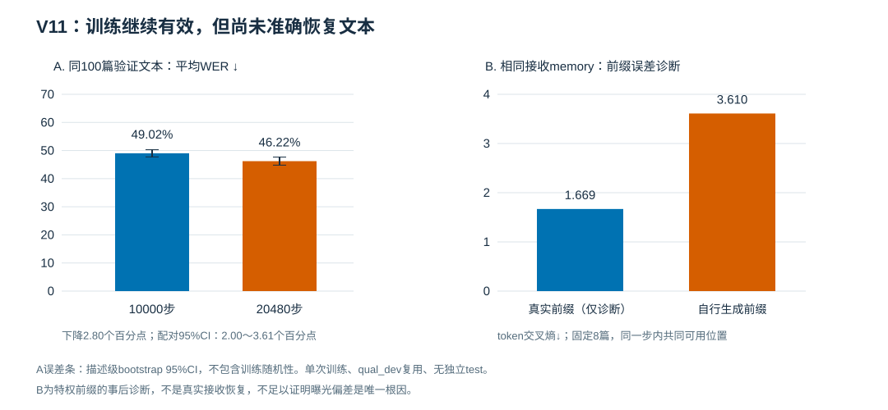

# V11 文本续训结果与接续计划
核验日期：2026-10-14。状态：训练/评价完成，CPU 记录重验通过；模型质量仍为 `QUALITY_STOP`。
本页是本轮结果正本，不代表联合模块、FSO 抗噪、数字基线或实测硬件已经成功。

## 1. 本轮到底运行了什么

- 数据：DOCCI 官方 train 中固定 2048 条；官方 qual_dev 全部 100 条用于验证。没有使用 test/qual_test 训练或选模。验证集已经反复用于研究诊断，不能作为独立测试集。
- 网络：冻结已有 BART，训练文本私有 codec（25,618,432 个可训练参数）；不使用 CLIP、Long-CLIP、Common、图像、扩散或 FSO。
- 协议：原始完整 BPE 按每段 62 个正文 token 分段；固定公开九段，每段 32×64 实值特征，包括所有空段，合计 18,432 个实数 / 9,216 个连续复载荷符号，R=1。九段不是九次重复；不免费传输原文长度或 mask。
- 条件：仅 clean、纯交叉熵 CE。记录中的 40 dB 是 clean 哨兵，不是实际测得的物理链路 SNR。
- 从已核验 10,000 步权重启动，新增 10,480 步到累计 20,480 步（batch=2，累计约 20 轮）。使用 NEW AdamW，阶段 LR 3e-5→1e-5，不是恢复旧优化器的精确续训。
- 使用预先固定的末次检查点；中途探针只作诊断，没有按验证集挑最佳 checkpoint。本次文档更新没有启动或改变任何服务器任务。

运行标识：`v10_docci_text_continue_v11_20261014_201245`。
只读重收集标识：`v10_docci_text_continue_v11_20261014_201245_recollect02`。
模型与数据仍留在原服务器的 `experiment_results/`、`pretrained/` 和数据目录，不包含在本次 Git 提交中。

## 2. 主要结果：确有小幅改善，仍远非准确恢复

| 指标 | 原 10,000 步 | 累计 20,480 步 |
|---|---:|---:|
| qual_dev 100 条平均 WER↓（均值 ± 描述间 SD） | 49.02% ± 6.38% | 46.22% ± 7.14% |
| qual_dev 语料级 WER↓ | 49.53% | 47.00% |
| 固定 TRAIN 诊断 32 条平均 WER↓ | 41.46% | 32.53% |
| qual_dev 平均 CER↓ | 41.63% | 38.46% |
| qual_dev 平均 BLEU2↑ | 0.5234 | 0.5594 |
| 首段相邻 BPE 重复比例↓ | 23.21% | 15.79% |
| 所有公开段均自然 EOS 的描述数 | 47/100 | 50/100 |
| 应有 62 正文 BPE 的段提前 EOS | 68/196 | 70/196 |
| 整篇原文完全一致 | 0/100 | 0/100 |

宏平均 WER 下降 **2.80 个百分点**，相对 WER 降幅 5.71%；同 100 条描述中，72 条改善、6 条持平、22 条变差。配对描述级 bootstrap（5,000 次、seed=42）对新−旧 WER 给出 95% 区间 **[-3.61, -2.00] 个百分点**。这是单次训练、固定且复用 qual_dev 下的条件描述性区间，不涵盖训练种子、数据集选择或独立测试不确定性；没有另做 p 值假设检验，不能宣称普遍显著收益。SD 是描述间标准差，不是多次训练的标准差。完整未舍入数值见 [metrics.json](metrics.json)。

图 A 为同 100 条 qual_dev 描述的宏平均 WER；误差条为描述级 bootstrap 95% 区间。图 B 为固定 8 条描述、同一步内共同可用正文位置上的 token CE。图 B 使用特权真实前缀作诊断，不是实际接收恢复，也不将其输入部署接收端。本发布修正了先前本地 SVG 的 B 面板柱高/颜色编码错误，没有修改数值或原始记录；已检查 SVG XML 和柱高计算，未把浏览器截图 QA 当作已完成。

## 3. 对照与错误性质

正常接收、打乱接收 memory、清零 memory 的最终宏平均 WER 分别为 **46.22%、112.75%、388.49%**。超过 100% 是插入错误导致。对照支持模型依赖接收信息，但不证明准确恢复或图文互促。

满 62 正文 BPE 的 196 段中，提前 EOS 为 70 段，EOS 恰在预期长度为 64 段，未 EOS 而到容量上限为 62 段。不要把容量停止全部叫作循环，也不要把自然 EOS 自动叫作提前截断。606 个空公开段均正确结束；源长度仅用于事后评价。提前 EOS 段的正文长度缺口合计从 90 降至 87 BPE，次数和丢失长度必须分别理解。

一种固定 tie-break 的最小单位词编辑对齐：旧替换/删除/插入 = 5262/722/569，新 = 5024/560/634（源词 13,230）。新错误约 80.8% 是替换；删除减少而插入增加。首段相邻重复下降不等于全篇插入错误减少。编辑对齐有多解，不是唯一语义根因。

## 4. 为什么不能只靠增加步数或防重复

固定 8 条 qual_dev 的 token 加权事后诊断：

| 条件 | 10,000 步 | 20,480 步 |
|---|---:|---:|
| 原生 BART 原始 memory + 真实前缀：正文 CE | 0.0434 | 0.0434 |
| 学习接收 memory + 真实前缀：正文 CE | 1.6991 | 1.6659 |
| 学习接收 memory + 真实前缀：正文 token accuracy | 59.08% | 61.73% |
| 同步共同可用位置：真实前缀 CE | 1.7003 | 1.6690 |
| 同步共同可用位置：自由生成前缀 CE | 3.3992 | 3.6098 |

前两行使用全正文 token；后两行在每一步内部使用共同可用位置（10,000 步 1018 个，20,480 步 1017 个），不得混合分母。即使给真实前缀，学习接收 memory 仍有明显内容误差，提示内容保真/解码接口仍有限；自由前缀误差与位置漂移又增加困难。这不证明曝光偏差是唯一根因。

同 100 条原生 BART 未传输参考：整篇原始 memory 自由生成 WER 2.63%、整篇精确 79/100；分段原始 memory 自由生成 WER 4.56%，58/100 描述至少一个公开段未 EOS。它们包含未经传输的原始 memory 和源 mask，不是同资源基线或信道性能上界。

## 5. 门槛和收集状态

旧质量规则保持不变。验证 WER 46.22% 满足旧 60% 限制，memory margin 也通过；但全 EOS 条件只达到 50/100。TRAIN 诊断 32 条 WER 32.53% 仍高于旧 20% 限制，20/32 条存在容量停止。因此 `QUALITY_STOP` 不是只放宽 EOS 规则就能解释为成功。原生分段参考也无法满足“全体零容量停止”，支持后续独立审查该规则的实用性；本次没有改变规则。

收集原先失败于 FP32 pooled mean 与 Python 加权段均值的极小差异。本次采用已发布的 CPU-only 修复验收器，完整 280 项汇总均通过，其中 31 项被旧严格容差拒绝；最大绝对差 5.103898068625767e-7，最大差/声明数值界约 0.009455。615 个原轻量文件字节与哈希保持一致，完整矩阵、帧、指标、训练历史、源码和检查点身份记录核验通过。没有重跑 GPU 推理，没有载入上传的权重二进制，上传脚本没有被作为可信验收器执行。见 [verification.json](verification.json)。

上传档案：`v10_docci_text_continue_v11_records_collect02.tar.gz`。
SHA-256：`1dc0e70bb758aa304940145d3f3b7f06e41d3e8954381db54d419eee1382f01f`。
档案 628 个普通文件、解压后 43,977,961 字节；本仓库只提交派生汇总，不提交该档案、原始 DOCCI 描述、图片、完整逐条页面、缓存或权重。

GPU 程序日志总墙钟约 24.48 分钟；训练阶段含中途探针约 18.49 分钟。峰值 allocated 2.17 GiB、reserved 2.51 GiB。它们不包括 CPU 收集重试，也不是纯训练循环或硬件通信时延 benchmark。

## 6. 接下来优先做什么——计划，尚未实施

1. 暂不盲目延长纯 CE；先做 clean 的 **CE vs CE+原生 BART 输出分布蒸馏**，两个分支保持初始权重、TRAIN 顺序、样本数、优化器、LR、更新数、解码规则和 9,216 复符号预算一致。
2. 教师只在 TRAIN 损失中使用原始 chunk memory，eval/no-grad；接收端仍只用收到的符号和公开协议。原文、长度、源 mask、教师 memory/logits 都不得直接进入实际 RX；完整 50k 词表分布不是传输载荷。
3. 优先看接收 memory 的真实前缀正文 CE/accuracy 和固定独立于 TRAIN 的验证 WER、重复/EOS 指标，而不是只看训练 loss。固定末次检查点，先写明训练预算和判定规则。
4. 再单独测试 scheduled sampling 或训练期 unlikelihood，避免与蒸馏同时叠加而无法归因。若提升不迁移，再单独扩大 TRAIN。
5. clean 文本可靠性改善后再考虑 FSO 与 Common/CLIP/图文联合；并补齐真正同资源的数字基线和独立测试。

蒸馏概念参考 [PyTorch 官方教程](https://docs.pytorch.org/tutorials/beginner/knowledge_distillation_tutorial.html)。该教程是分类例子，不是 BART/DOCCI/JSCC 复现；这里是基于诊断形成的实验假设，没有效果保证，不要求升级服务器 PyTorch 或下载新模型。

## 7. 新会话接续入口

先读根目录 `AGENTS.md` / `CLAUDE.md`、工程规范、[当前状态](../../CURRENT_STATUS.md)、[共享交接](../../HANDOFF.md) 和本页，再读 [V11 模块](../../../docci_text_continue_v11/README.md) 与 [收集修复](../../../docci_text_collect_fix_v11/README.md)。

代码证据：V11 训练发布 `4fcd4959d707ff0cc78ae74d30ff886a93db4929`；收集修复发布 `14db2ef492405bde89ebdc184ce1ac83ef527b8e`。训练/数据/检查点仍需从原服务器或用户提供的 records 核对。只看仓库可了解状态和计划，但不能替代原始记录再验收。本轮结论没有证明图文互促、压缩比、连续传输抗噪或优于数字通信。

