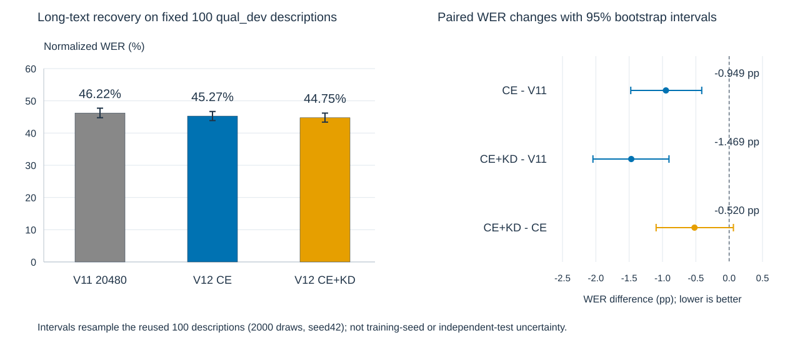
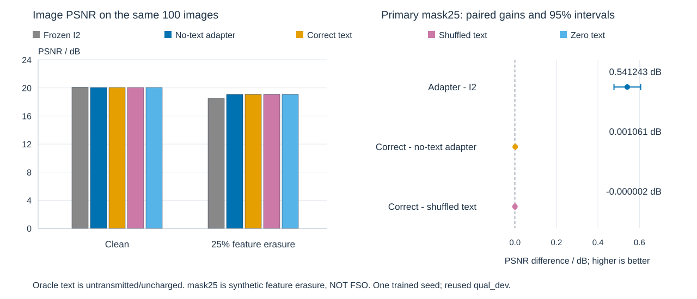

# V12：已上传实测结果与核验结论（2026-10-15）

状态：用户返回服务器 records collect02，已核验；不是仅写好代码。
原始包 SHA-256：`434d8e43521c9fa75d16b6f0e0d968daf566172ab02b392e4ca374eb0e614683`。
本页取代 CURRENT_STATUS / 旧 HANDOFF 中“V12待运行/待收集”的当前状态；历史记录不改写。

## 文本：小幅改善，不证明 KD 稳定有效

同一训练 seed42、2048条TRAIN、反复使用的100条官方qual_dev；clean、固定九公开段、9216复载荷符号、R1。
CE / CE+KD 均从同一 V11 20480末次权重开始，新AdamW，各4096更新、batch2；
KD系数0.5、温度2，只用TRAIN原生BART完整输出分布。BART冻结、固定末次权重，不按验证集选最好。

| 模型 | 宏平均规范化WER↓ | CER↓ | 全文一致 | 全九段自然EOS |
|---|---:|---:|---:|---:|
| V11 20480 | 46.2206% | 38.4639% | 0/100 | 50/100 |
| V12 CE | 45.2719% | 37.6150% | 0/100 | 64/100 |
| V12 CE+KD | 44.7521% | 36.5041% | 0/100 | 42/100 |

KD−CE = −0.5198个百分点；描述级配对bootstrap95%区间[−1.0956,+0.0637]个百分点，跨零。
48条改善、42条变差、10条持平。对V11的改善包含继续训练，不能全部归因于KD。
两组历史质量状态仍为 **QUALITY_STOP**；容量停止不自动等于循环，EOS也不自动等于正确完成。
**WER不是语义错误百分比，44.75% WER也不等于55.25%语义准确率。**
尚未测BERTScore、SPICE、人工事实保留率；不接受未经标注的“81%是近义替换”说法。

## 图像：有接收适配收益，未见内容特异文本互促

同100条qual_dev、同存储接收观测；I2/VAE冻结，每个适配器399843参数，2048更新、累积2；
4096复载荷符号、R1，交替clean/mask25训练。文本为未传输、未计费的原文oracle；
Long-CLIP池化语义仅供接收残差条件，**不是等总资源图文联合通信**。

| 组别 | clean PSNR/dB | mask25 PSNR/dB |
|---|---:|---:|
| 冻结I2 | 20.091297 | 18.526520 |
| 无文本适配器A0 | 20.054746 | 19.067762 |
| A1正确原文 | 20.055728 | 19.068823 |
| A1打乱原文 | 20.055572 | 19.068825 |
| A1清零文本 | 20.057354 | 19.067790 |

- A0对冻结I2：mask25增益+0.541243dB，95%配对区间[+0.477323,+0.606083]，100/100改善；clean下降0.036551dB，一起报告。
- A1正确文本对A0：mask25仅+0.001061dB，幅度极小，不能当实用互促成功。
- 正确对打乱文本：mask25为−0.00000183dB，95%区间[−0.00023231,+0.00022171]，未见内容特异收益。
- **mask25只是25%实特征人工擦除，不是FSO、湍流、天气或低SNR实验。** 未用扩散，LPIPS未测，无数字基线。

## 核验与范围

本地既有独立分析：735个原始轻量文件哈希一致，可信本地CPU完整验证与包内派生分析一致；
未执行上传包中的Python，未读取pickle/大权重，未重新GPU推理全100图。
保存PNG子集作MSE界复核，不等于重算全部SSIM/LPIPS。
完整原始图文、records和权重仅私有保留，不提交到公开仓库。

四训练阶段合计约41.80分钟，GPU主程序约61.43分钟；原服务器CPU收集约13.79秒。
这些不是V13评价时间，也不是对新硬件的保证。

所有区间均为单个训练seed下的2000次描述级配对bootstrap、分析seed42；
qual_dev多次使用，不是独立test，也不包含训练种子随机性。次要多项比较为探索性。
[aggregate.json](aggregate.json)仅公开聚合数值，图表与范围说明；不含原始描述或恢复文本。

## 下一步：V13离线语义评价，不先扩大训练

见 [V13协议与运行说明](../../../docci_semantic_eval_v13/README.md)。
主评价为固定抽取30条描述的人工事实审核；辅助为独立Longformer BERTScore与历史字面指标。
V11/V12的旧质量判定保留，新语义协议另列。未来同资源数字/带噪FSO比较仍NOT_RUN。
